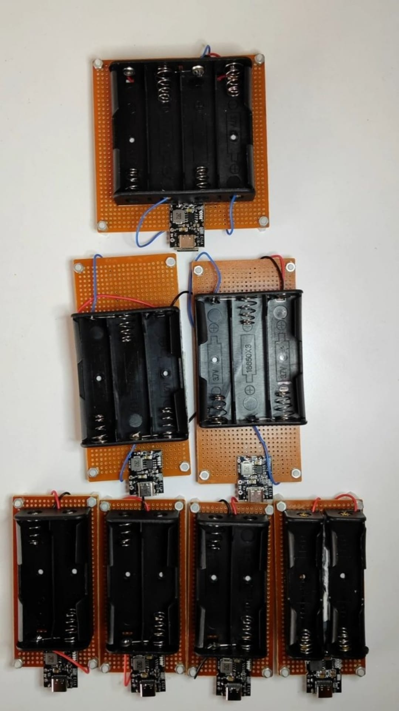
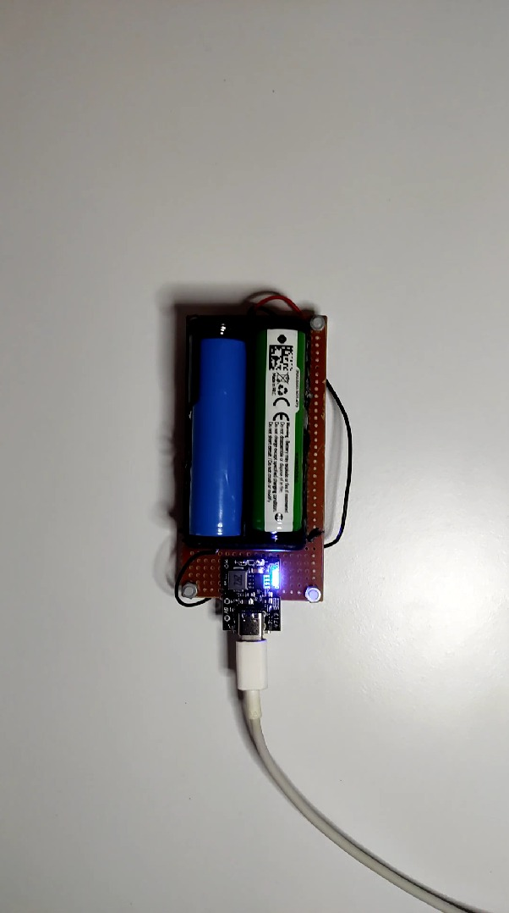

# Zaritech 18650 Power & Charging Ecosystem 🔋

Welcome to the official repository for the **Zaritech Standard 18650 Series & Charging Infrastructure** — a modular, high-reliability power ecosystem engineered by **Zaritech Batteries** (A division of **Zaritech Dynamics**).

Unlike standard linear charging setups, this infrastructure utilizes high-efficiency integrated Power Management ICs (PMICs) to deliver simultaneous high-current charging and boost conversion for industrial and hobbyist projects.

---

## 🛠️ Hardware & Topology Specs
Our modular charging and prototyping testboards are designed for optimal thermal efficiency, state-of-charge tracking, and stable high-current paths:

*   **Power Management IC (PMIC):** FM5324 Integrated 10W Synchronous Boost Li-Ion Battery Charger.
*   **Power Ratings:** Supports true **5V / 2A (10 Watt)** synchronous buck charging and high-efficiency synchronous boost output.
*   **Input Interface:** Modern, high-durability USB Type-C port for safe and fast 5V power delivery.
*   **Output Interfaces:** 
    *   Standard USB Type-A Output Port (5V/2A) for powering external microcontrollers or devices.
    *   Dedicated **External 5V Output Pins** directly integrated on the PCB substrate.
*   **Telemetry & Indicators:** 4-stage intelligent LED battery level indicator displays real-time capacity and charging status (25%, 50%, 75%, 100%).
*   **Battery Topologies:** Multi-cell parallel charging docks built on rigid prototyping substrates with secure standoffs, verified for industrial 18650 form-factors (Zaritech Standard Series).

---

## 🗺️ Visual Architecture & Production
The modular development timeline, cascading array configurations, and official cell-sorting tiers are visually detailed below:

### Modular Prototyping Array

### Verified Cell Tier Lineup

---

## 📥 Commercial Acquisition & Distribution
To purchase custom-soldered modular arrays featuring the FM5324 10W architecture, certified Zaritech Standard 18650 cells, or to request bespoke battery pack designs, please contact our international distribution team through our official [Zaritech Labs Instagram](https://instagram.com).

---

## ⚖️ License & Governance
This infrastructure is maintained under the **MIT License** and governed under the engineering standards of **Zaritech Dynamics**.

*May Allah grant us success on this path.*
